<p align="center">
  
</p>

<p align="center">
  <a href="https://github.com/Normansrule/solar-rover/actions/workflows/ci.yml"></a>
  
  
</p>

Solar Rover is a 3D-printed, four-wheel-drive robot car with a solar roof and a small crane arm on a turret, styled after the repair vehicle from Red Alert 2. You can drive it with a handheld remote, from your phone over WiFi or Bluetooth, or hand the wheel to a reinforcement learning (RL) agent running on a Raspberry Pi inside it. It's for hobbyists who own a 3D printer and want a robot that does a bit of everything (driving, picking things up, charging itself in the sun, learning to drive in a simulator) without designing a circuit board or spending a fortune: every part prints on a 220 mm bed and the electronics cost about $211.

**[Try the crane on the website](https://normansrule.github.io/solar-rover/docs/)**: it's the same arm, drawn to scale, and you can drag it around and pick up a ball.

## Key features

- **Prints on a normal printer.** 31 parts in PETG (polyethylene terephthalate glycol), tires in TPU (thermoplastic polyurethane), all sized for a 220 × 220 mm bed. It goes together with M3 screws into heat-set inserts, and M2.5 or M2 for the small boards.
- **Charges itself.** A 44 Wh pack of four 18650 cells, charged by two roof panels or a 12 V wall adapter through one MPPT (maximum power point tracking) charger. A temperature probe stops charging outside 0 to 45 °C. When the battery runs low the car goes looking for sun, and when it's critical it parks and sleeps until it has charged.
- **Picks things up.** A four-joint arm (base, shoulder, elbow, wrist) with a two-finger gripper reaches the ground about 11 cm ahead of the nose and lifts about 50 g.
- **Point and it reaches.** In the phone app you drag to where you want the gripper and the app works out the joint angles with the same inverse kinematics the Pi agent uses. If a spot is out of reach, it tells you why instead of doing something odd.
- **Four ways to drive it.** A printed handheld remote over ESP-NOW (Espressif's router-free radio link), a phone app over WiFi, BLE (Bluetooth Low Energy), and the agent over a serial link. In Auto mode the agent drives and any touch from you takes over for 2 seconds.
- **Learns to drive.** A simulator, a numpy-only Evolution Strategies trainer, an optional PPO (Proximal Policy Optimization) trainer, and a trained driving policy ready to run on the Pi.
- **No custom circuit board.** Only off-the-shelf modules, Dupont jumpers, screw terminals and lever connectors.
- **Checked before you print.** CI (continuous integration) builds both firmwares, runs the simulator and agent tests, checks every part fits the bed, and collision-checks the assembly in every arm pose.

## Screenshots

<p align="center">
  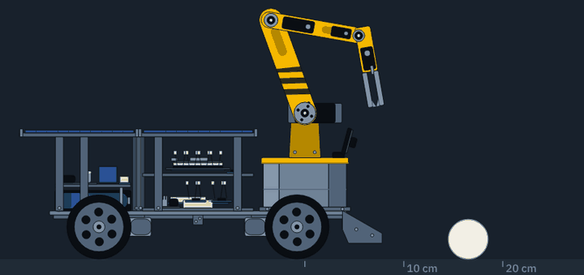
  <br><sub>The crane on the website, recorded as is: pick, close, carry, drop. It's the same drawing and maths as the one in the phone app.</sub>
</p>

| The phone app, night shift | The phone app, workshop daylight |
|---|---|
| 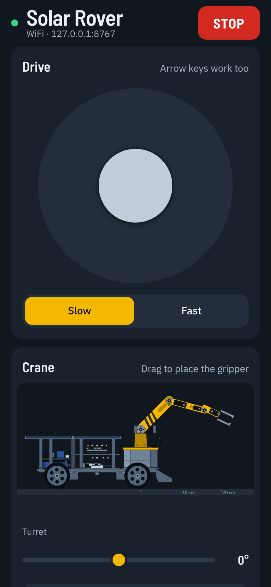 | 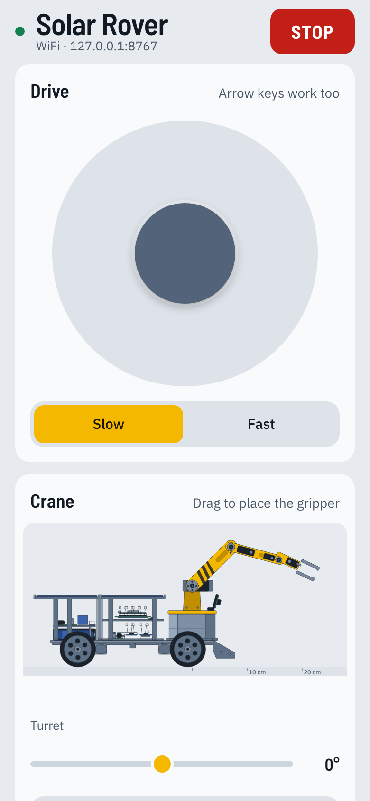 |

<p align="center">
  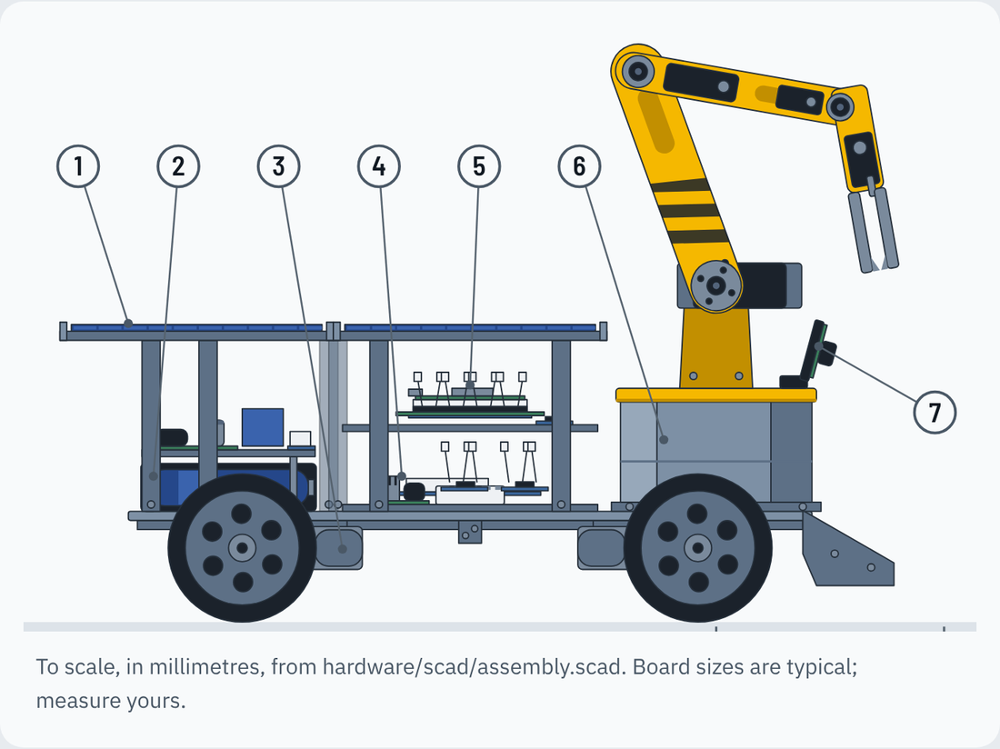
  <br><sub>"What's where" on the website: the same drawing, with the parts numbered and explained.</sub>
</p>

<p align="center">
  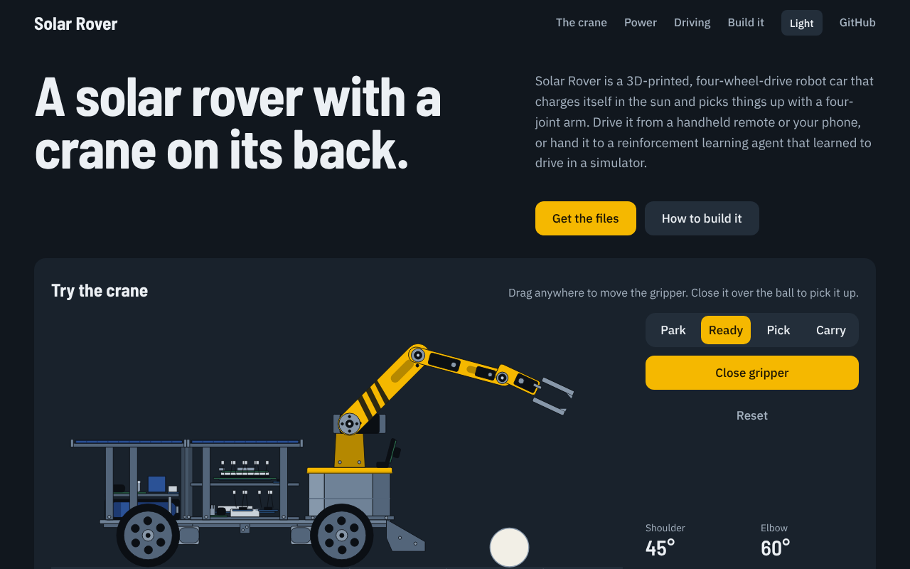
  <br><sub>The website, <a href="docs/index.html">docs/index.html</a>, served by GitHub Pages.</sub>
</p>

| Turn it round | The arm's firmware poses |
|---|---|
| 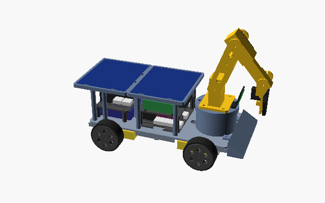 | 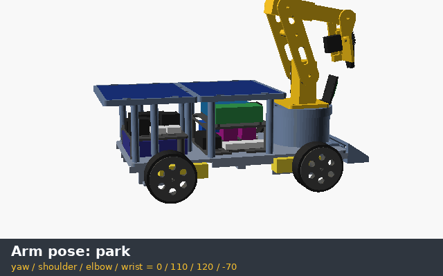 |

<p align="center">
  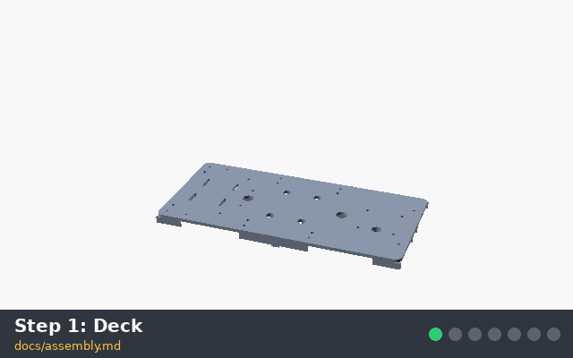
  <br><sub>The build, one step of <a href="docs/assembly.md">docs/assembly.md</a> at a time, rendered from the real 3D model.</sub>
</p>

> **Photos of the real thing go here** once it's printed and built. Until then, everything above is rendered from the CAD (computer-aided design) model and the actual app and website.

<details>
<summary><b>Wiring diagrams</b> (generated from the firmware pin map)</summary>

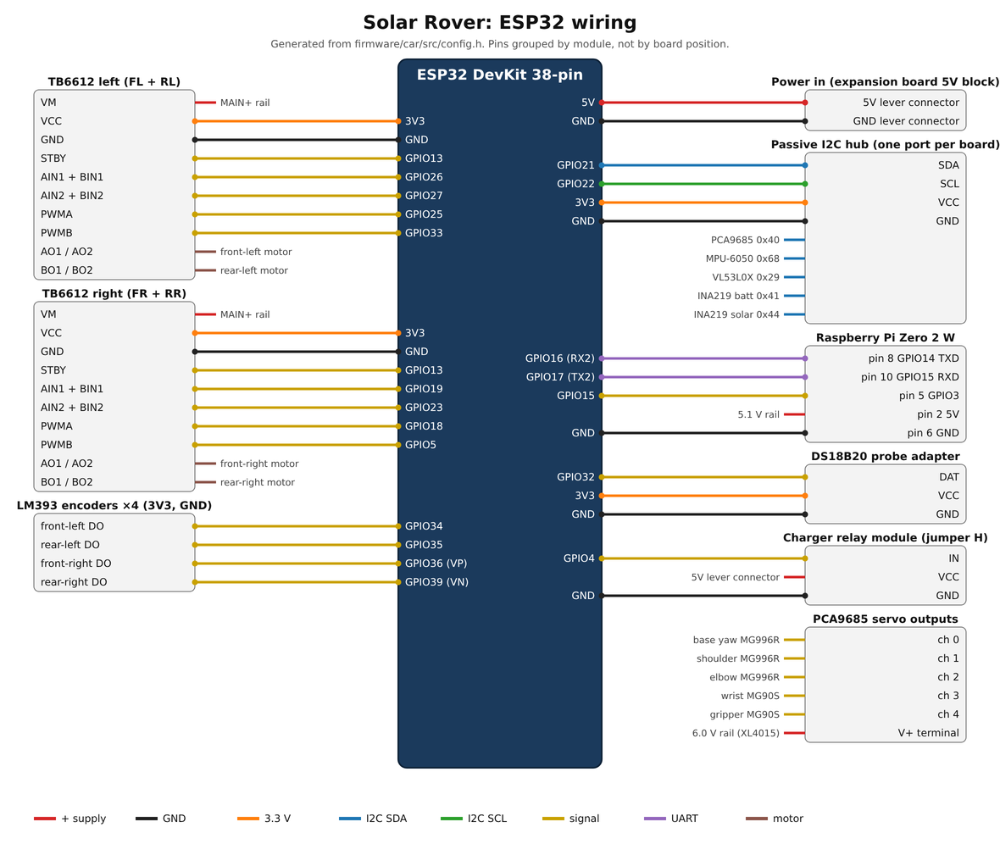
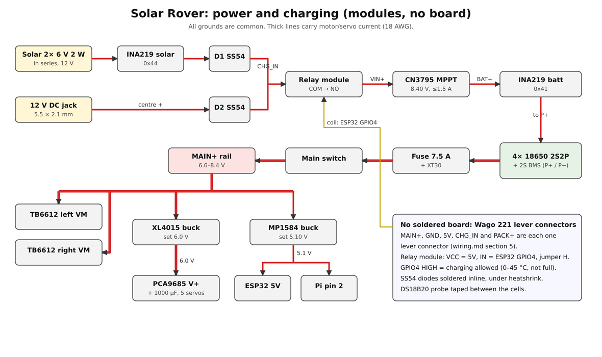
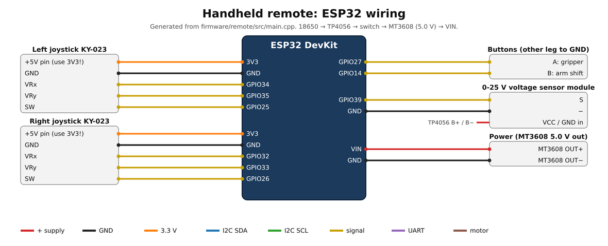

</details>

## Progress

<p align="center">
  
</p>

<!-- progress:start (generated by tools/progress.py) -->

**15 of 32 tasks done.** Edit [docs/progress.yaml](docs/progress.yaml) and run `python3 tools/progress.py` to update this list and the chart above.

<details><summary><b>Design</b>: 4 of 4</summary>

- [x] 3D model of all 31 printed parts (OpenSCAD, 220 mm bed)
- [x] Pin-by-pin wiring and diagrams, no custom PCB
- [x] Parts list with prices (about $211)
- [x] Collision check of every part and arm move (fit_check.py)

</details>
<details><summary><b>Software</b>: 8 of 8</summary>

- [x] Car firmware: drive, arm, power, WiFi, BLE, ESP-NOW (compiles)
- [x] Handheld remote firmware (compiles)
- [x] Phone web app
- [x] Simulator and trained driving policy
- [x] Raspberry Pi agent with tests
- [x] PPO trainer run end to end
- [x] Wheel self-test for bring-up (TEST WHEELS)
- [x] Logger and simulator fitter for real-car runs

</details>
<details><summary><b>Publish</b>: 3 of 3</summary>

- [x] Rename to Solar Rover
- [x] Animated README and progress tracker
- [x] Create the GitHub repo and see CI go green

</details>
<details open><summary><b>Parts</b> (now): 0 of 3</summary>

- [ ] Order the electronics and screws from bom.csv **(next)**
- [ ] Print the fit-test coupon and set the MEASURE values
- [ ] Print the remaining parts (PETG + TPU tires)

</details>
<details><summary><b>Build</b>: 0 of 5</summary>

- [ ] Deck, motors, encoders and wheels
- [ ] Battery, charger and power tray
- [ ] Logic tray: ESP32, Pi, IMU
- [ ] Turret, arm and gripper
- [ ] Nose, camera and solar roof

</details>
<details><summary><b>Bring-up</b>: 0 of 4</summary>

- [ ] First power-up and wheel direction check
- [ ] Servo calibration
- [ ] Charging check: wall, sun and temperature cut-off
- [ ] Handheld remote paired

</details>
<details><summary><b>Autonomy</b>: 0 of 5</summary>

- [ ] Drive from the phone and the remote
- [ ] Agent drives on the Pi
- [ ] Tune the simulator from real runs and retrain
- [ ] Spot, drive to and pick up an object
- [ ] Find the sun and recharge on its own

</details>

<!-- progress:end -->

## Setup and usage

All commands are for Ubuntu or WSL (Windows Subsystem for Linux) and start from an absolute path, so it doesn't matter which folder your terminal is in. They assume the project lives in `~/solar-rover`.

**1. Get it onto your machine (and GitHub).** [docs/github-setup.md](docs/github-setup.md) has one copy-paste block that finds the downloaded zip in your Linux or Windows Downloads folder, unpacks it to `~/solar-rover` and runs `tools/publish.sh`.

**2. Build the car.**

| Step | What you do | Guide |
|---|---|---|
| Order parts | The modules, motors, servos, cells, panels and screws. About $211 for the car, $230 with the remote. | [bom.csv](docs/bom.csv), [modules.md](docs/modules.md) |
| Fit test | Print the wheel, encoder disc, motor clamp and roof post. Measure your parts against the **MEASURE** values in `hardware/scad/config.scad`, fix and re-export. | [assembly.md](docs/assembly.md#build-steps) |
| Print | All 31 parts in PETG, tires in TPU. Set the heat-set inserts. | [assembly.md](docs/assembly.md#print-settings) |
| Assemble | Chassis and motors, then power, then the ESP32 and Pi on the logic tray, then the turret, arm, nose and solar roof. Set every buck converter with a multimeter before you connect anything. | [assembly.md](docs/assembly.md#build-steps), [wiring.md](docs/wiring.md) |

**3. Flash the car** (needs PlatformIO, see [software.md](docs/software.md)):

```bash
cd "$HOME/solar-rover/firmware/car" && pio run -t upload
```

**4. Drive it.** Join the car's WiFi network `SolarRover-XXXX` on your phone and open **http://192.168.4.1**. The app connects by itself and comes straight from the car, so it works with no internet. The stick drives; in the crane view, drag to where you want the gripper or tap a pose. **STOP** stays pinned to the top of the screen (Escape does the same on a keyboard). Bluetooth and the handheld remote are covered in [software.md](docs/software.md#3-phone-app).

**Turn on the website.** Once the repo is public on GitHub, go to Settings → Pages and deploy from the branch `main`, folder `/ (root)`. The website is then at `https://normansrule.github.io/solar-rover/docs/`, and the phone app at `.../firmware/car/web/` (which is how you use it over Bluetooth from Chrome).

**5. Train and run the agent** on your PC:

```bash
cd "$HOME/solar-rover/sim" && python3 -m venv .venv && .venv/bin/pip install -r requirements.txt
.venv/bin/python -m solar_rover_sim.train_es --generations 400 --task mixed --out "$HOME/solar-rover/agent/models/drive"
cd "$HOME/solar-rover/agent" && python3 -m venv .venv && .venv/bin/pip install -r requirements.txt
.venv/bin/python -m solar_rover_agent.main --url ws://solar-rover.local/ws --dry-run
```

Drop `--dry-run` to let it drive, then set the app to **Auto** or **Agent**. To run it on the Pi instead, see [software.md](docs/software.md).

**6. Keep the tracker current.** When you finish a task, change its `status` in [docs/progress.yaml](docs/progress.yaml), then:

```bash
cd "$HOME/solar-rover" && python3 tools/progress.py && bash tools/publish.sh
```

## Project structure

```
hardware/scad/        OpenSCAD sources: config.scad (every dimension), lib.scad, parts/, assembly.scad
hardware/stl/         Ready-to-print STL (stereolithography) files
firmware/car/         ESP32 car firmware (PlatformIO)
firmware/car/web/     The phone app and the shared design system:
                        index.html   the app (inlined and gzipped into the firmware at build time)
                        tokens.css   colours, type, spacing and motion for the app and website
                        crane.js     the drawn-to-scale crane, its inverse kinematics and springs
                        fonts/       Barlow Semi Condensed and IBM Plex Sans (SIL Open Font License)
firmware/remote/      ESP32 handheld remote firmware
firmware/common/      Packet format shared by the car and the remote
sim/                  Simulator, ES and PPO trainers, MuJoCo 3D model, tests
agent/                Raspberry Pi agent, trained policy, systemd service, tests
tools/                STL export, renders, README graphics (progress.py, rover_svg.js), fit and collision checks, publish script
docs/                 The guides below, the website (index.html, site.css, site.js) and docs/img
```

| Doc | What's in it |
|---|---|
| [design.md](docs/design.md) | How it works and why, plus what changed since v0.1 |
| [bom.csv](docs/bom.csv) | The bill of materials, with prices |
| [modules.md](docs/modules.md) | Every electronic module and what to check when buying |
| [wiring.md](docs/wiring.md) | Pin-by-pin wiring for the car, power board, Pi and remote |
| [assembly.md](docs/assembly.md) | Print settings, screw list, step-by-step build |
| [software.md](docs/software.md) | Flashing, the phone app, Pi setup, training, running the agent |
| [protocol.md](docs/protocol.md) | Commands, telemetry, modes and safety rules |
| [progress.yaml](docs/progress.yaml) | The task list behind the progress chart |
| [github-setup.md](docs/github-setup.md) | Putting this folder on GitHub from Ubuntu |
| [inspiration.md](docs/inspiration.md) | The Red Alert 2 vehicle it's styled after |

## Design

The concept is **Field Service**. The look borrows from the Allied IFV (infantry fighting vehicle) in Red Alert 2, the version that carries an engineer and swaps its missile turret for a repair crane. So the app and website are styled like the service manual for a work vehicle: gunmetal steel, hazard yellow on the crane, and signal red kept for one thing only, stopping.

The same rules run through the phone app, the website and these README graphics, from one shared file, `firmware/car/web/tokens.css`:

- **One accent, with a job.** Hazard yellow (#f5b800) marks the crane and whatever is selected or happening now. Everything else stays in the steel greys, so yellow always means something. Red only ever appears on STOP and on real faults.
- **Two shifts.** Night shift (dark) and workshop daylight (light) follow your device's setting, and the website has a switch. Daylight matters here: a solar car gets driven outside, in the sun.
- **Type like a manual.** Barlow Semi Condensed for headings and readings, whose squared-off shapes suit stencilled vehicle markings, and IBM Plex Sans for reading. Both are open source. Numbers use tabular figures so they don't jitter as they change.
- **A spacing scale, not guesses.** Every gap is a step on a 4 px scale (4, 8, 12, 16, 24, 32, 48, 64, 96, 128), and the website sits on a 12-column grid like a manual spread.
- **Motion with weight.** The crane moves on hydraulic springs, slightly underdamped, so it settles like a real arm instead of sliding on a timer. Buttons press down slightly (140 ms) and the joystick eases home when you let go. The one authored moment is the crane unfolding from its transport pose when the website opens, and the README banner plays the same move. Nothing loops for decoration, and all of it switches off when your device asks for reduced motion.
- **The centerpiece is the real thing.** The crane is drawn to scale from `hardware/scad/config.scad` and `assembly.scad`, down to the posts, trays, boards, servos, motors and wheel hubs, in a flat cutaway style with thin ink outlines like a service manual. It uses the joint limits and poses from the firmware, and solves its angles with the same maths as `agent/solar_rover_agent/arm_ik.py`. In the app it shows what the car reports; on the website it's a sandbox with a ball to pick up.
- **Honest states.** The app says when it's connecting, when it's lost the car (with a countdown and a retry button) and when the battery is low. Readings go grey when they're stale, so old numbers never look live.
- **Usable by everyone.** Everything works from a keyboard (the crane handle takes arrow keys, Enter opens and closes the gripper), focus is always visible, touch targets are at least 44 px, and text meets WCAG (Web Content Accessibility Guidelines) AA contrast in both themes.
- **No decoration standing in for content.** No gradients, glows, emoji, stock card grids or filler icons. The pictures are renders of the real model and screenshots of the real app.

The README graphics are SVG (scalable vector graphics) files drawn by `tools/progress.py` from `docs/progress.yaml`, with the app's fonts embedded so they look the same everywhere. The banner's rover is the website's own drawing: `node tools/rover_svg.js` exports it from `crane.js`, and CI checks the two still match.

## License

MIT, see [LICENSE](LICENSE). The fonts in `firmware/car/web/fonts` are under the SIL Open Font License (the `OFL-*.txt` files next to them).
