<p align="center">
  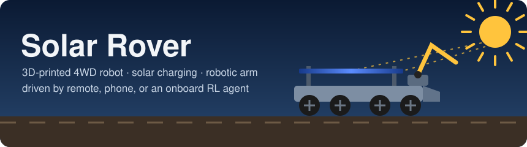
</p>

<p align="center">
  <a href="https://github.com/Normansrule/solar-rover/actions/workflows/ci.yml"></a>
  
  
  
  
</p>

A 3D-printed, solar-topped 4WD robot car with a 4-joint arm and gripper. It's inspired by the Red Alert 2 repair IFV, and you can drive it with a handheld remote, from your phone over WiFi or Bluetooth, or let an onboard reinforcement-learning agent drive it.

<p align="center">
  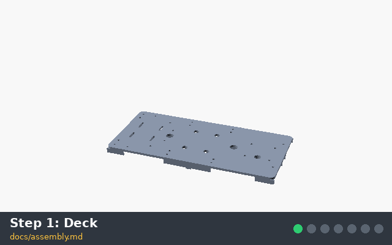
  <br><sub>The build, one step of <a href="docs/assembly.md">docs/assembly.md</a> at a time (rendered from the real 3D model).</sub>
</p>

## Progress

<p align="center">
  
</p>
<p align="center">
  
</p>

<!-- progress:start (generated by tools/progress.py) -->

**12 of 30 tasks done (40%).** ✅ done · 🔶 next · ⬜ to do. Edit [docs/progress.yaml](docs/progress.yaml) and run `python3 tools/progress.py` to update this section and the pictures.

| | Phase | Progress | Done |
|---|---|---|---|
| ✏️ | Design  | `██████████` | 4/4 |
| 💾 | Software  | `██████████` | 6/6 |
| 🚀 | Publish **now** | `███████░░░` | 2/3 |
| 🛒 | Parts  | `░░░░░░░░░░` | 0/3 |
| 🔧 | Build  | `░░░░░░░░░░` | 0/5 |
| ⚡ | Bring-up  | `░░░░░░░░░░` | 0/4 |
| 🤖 | Autonomy  | `░░░░░░░░░░` | 0/5 |

<details><summary><b>✏️ Design</b> · 4/4</summary>

- ✅ 3D model of all 31 printed parts (OpenSCAD, 220 mm bed)
- ✅ Pin-by-pin wiring and diagrams, no custom PCB
- ✅ Parts list with prices (about $211)
- ✅ Collision check of every part and arm move (fit_check.py)

</details>
<details><summary><b>💾 Software</b> · 6/6</summary>

- ✅ Car firmware: drive, arm, power, WiFi, BLE, ESP-NOW (compiles)
- ✅ Handheld remote firmware (compiles)
- ✅ Phone web app
- ✅ Simulator and trained driving policy
- ✅ Raspberry Pi agent with tests
- ✅ PPO trainer run end to end

</details>
<details open><summary><b>🚀 Publish</b> · 2/3</summary>

- ✅ Rename to Solar Rover
- ✅ Animated README and progress tracker
- 🔶 Create the GitHub repo and see CI go green

</details>
<details><summary><b>🛒 Parts</b> · 0/3</summary>

- ⬜ Order the electronics and screws from bom.csv
- ⬜ Print the fit-test parts and check the MEASURE values
- ⬜ Print the remaining parts (PETG + TPU tires)

</details>
<details><summary><b>🔧 Build</b> · 0/5</summary>

- ⬜ Deck, motors, encoders and wheels
- ⬜ Battery, charger and power tray
- ⬜ Logic tray: ESP32, Pi, IMU
- ⬜ Turret, arm and gripper
- ⬜ Nose, camera and solar roof

</details>
<details><summary><b>⚡ Bring-up</b> · 0/4</summary>

- ⬜ First power-up and wheel direction check
- ⬜ Servo calibration
- ⬜ Charging check: wall, sun and temperature cut-off
- ⬜ Handheld remote paired

</details>
<details><summary><b>🤖 Autonomy</b> · 0/5</summary>

- ⬜ Drive from the phone and the remote
- ⬜ Agent drives on the Pi
- ⬜ Tune the simulator from real runs and retrain
- ⬜ Spot, drive to and pick up an object
- ⬜ Find the sun and recharge on its own

</details>

<!-- progress:end -->

## Make it real, step by step

| # | Step | What you do | Guide |
|---|---|---|---|
| 1 | 🛒 **Order parts** | Buy the modules, motors, servos, cells, panels and screws. About $211 for the car, $230 with the remote. | [bom.csv](docs/bom.csv), [modules.md](docs/modules.md) |
| 2 | 🖨️ **Fit test** | Print the wheel, encoder disc, motor clamp and roof post. Measure your parts against the **MEASURE** values in `config.scad`, fix and re-export. | [assembly.md step 0](docs/assembly.md#build-steps) |
| 3 | 🖨️ **Print** | Print all 31 parts in PETG on a 220 × 220 mm bed, tires in TPU. Set the heat-set inserts. | [assembly.md](docs/assembly.md#print-settings) |
| 4 | 🔧 **Chassis and drive** | Bolt the deck halves together, fit motors, encoders and wheels. | [assembly.md steps 1–2](docs/assembly.md#build-steps) |
| 5 | 🔋 **Power** | Build the battery pack, charge tray and power tray. Set every buck converter with a multimeter first. | [wiring.md](docs/wiring.md), [assembly.md step 3](docs/assembly.md#build-steps) |
| 6 | 🧠 **Brains** | ESP32, Raspberry Pi Zero 2 W and IMU on the logic tray, wired with Dupont jumpers. | [wiring.md](docs/wiring.md), [assembly.md step 4](docs/assembly.md#build-steps) |
| 7 | 🦾 **Turret and arm** | Yaw servo, shoulder, elbow, wrist and gripper. | [assembly.md steps 5–6](docs/assembly.md#build-steps) |
| 8 | ☀️ **Body and roof** | Nose with the distance sensor, camera, roof posts and the two solar panels. | [assembly.md step 7](docs/assembly.md#build-steps) |
| 9 | ⚡ **Flash and power up** | Flash the car, check the wheels turn the right way, calibrate the servos, test charging. | [software.md](docs/software.md), [assembly.md steps 8–10](docs/assembly.md#build-steps) |
| 10 | 🎮 **Drive it** | Handheld remote, phone app over WiFi, or Bluetooth. | [software.md](docs/software.md), [protocol.md](docs/protocol.md) |
| 11 | 🤖 **Let the agent drive** | Train in the simulator, copy the policy to the Pi, switch to agent mode. | [software.md](docs/software.md#4-simulator-and-training-on-your-pc) |

## Gallery

| Turn it round | The arm's firmware poses |
|---|---|
| 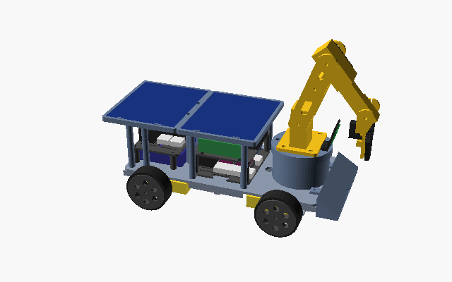 | 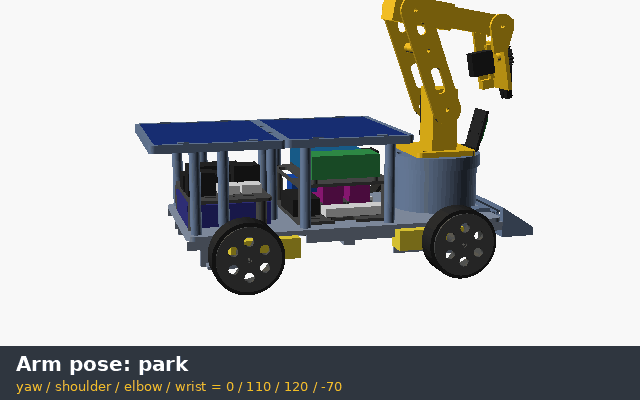 |

| Side | Top | Phone app |
|---|---|---|
| 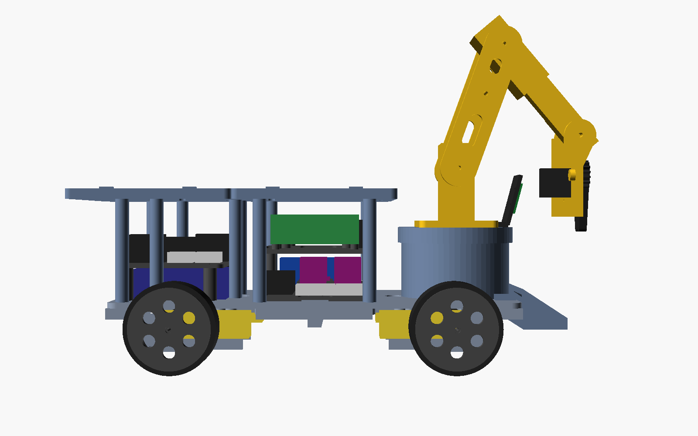 | 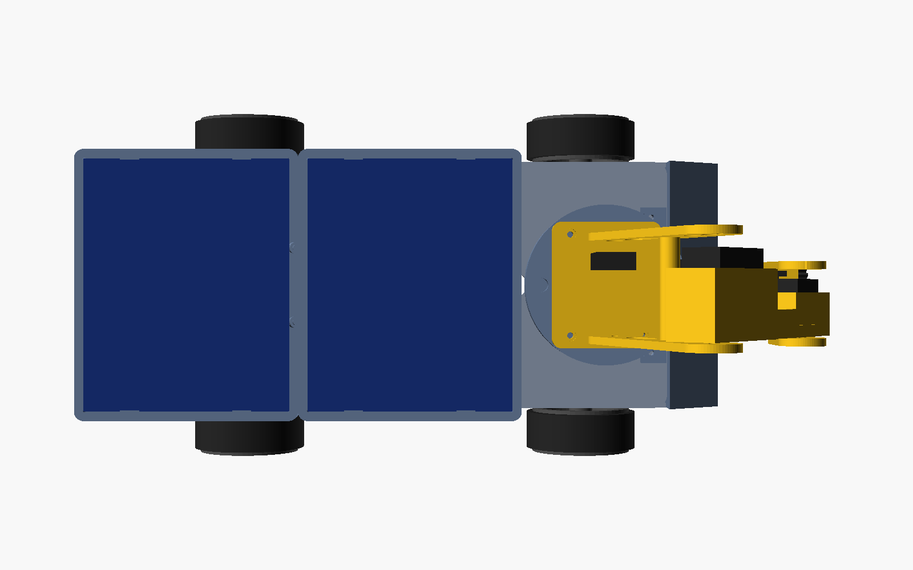 | 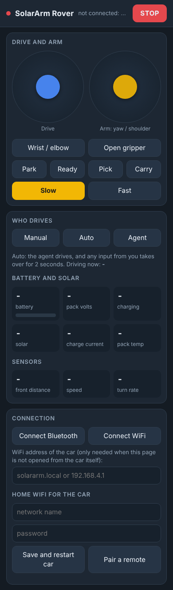 |

<details>
<summary><b>Wiring diagrams</b> (generated from the firmware pin map)</summary>

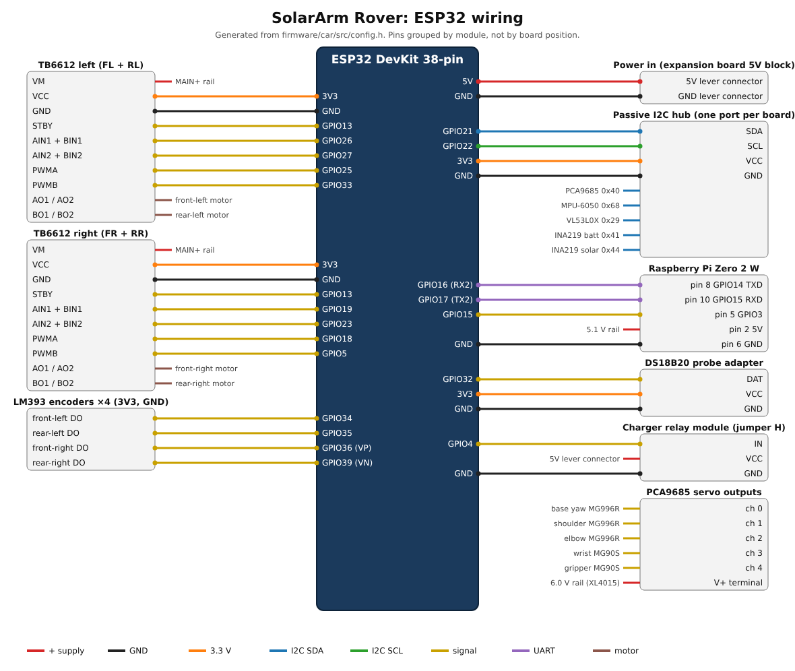
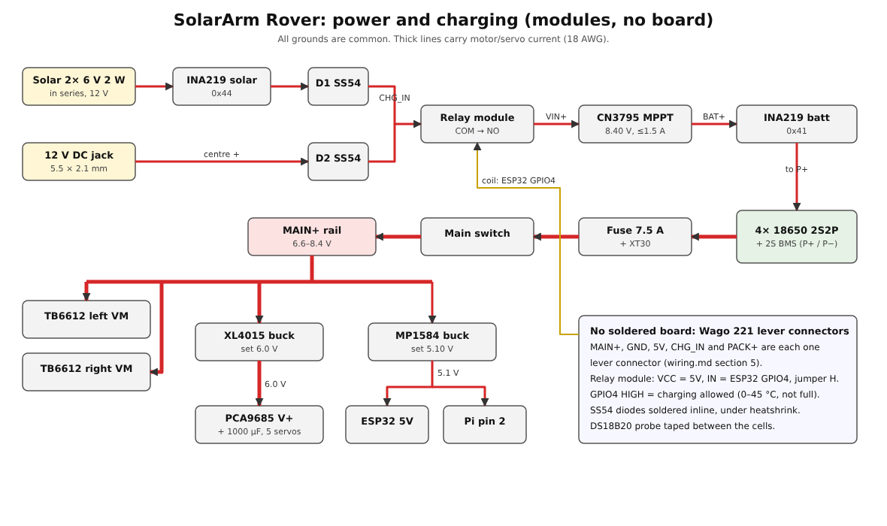
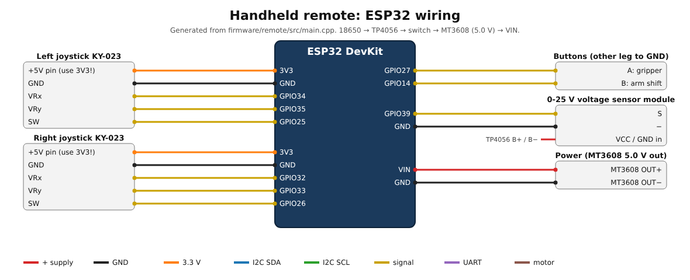

</details>

## Features

- **Every part prints on a 220 × 220 mm bed**: 31 STLs in PETG, plus TPU tires. It goes together with M3 screws into heat-set inserts, with M2.5 and M2 for the small boards.
- **Rechargeable:** a 44 Wh 2S2P 18650 pack, charged by two solar panels on the roof or by a 12 V wall adapter, through one MPPT charger. A temperature cut-off stops charging outside 0–45 °C.
- **Self-charging:** when the battery runs low, the car goes looking for sun. When it's critical, it parks and sleeps until the sun has charged it again.
- **Arm:** base yaw, shoulder, elbow, wrist and a gear-linked two-finger gripper. It reaches the ground about 10 cm ahead of the nose and lifts about 50 g.
- **Four ways to drive it:** a printed ESP-NOW handheld remote, a phone web app (WiFi), Bluetooth LE, and the agent on a Raspberry Pi Zero 2 W (or on a PC over WiFi).
- **RL included:** a Gymnasium simulator, a numpy-only Evolution Strategies trainer, a trained policy, and a MuJoCo 3-D model.
- **No custom circuit board:** only off-the-shelf modules, Dupont jumpers, screw terminals and lever connectors.
- **Parts cost:** about $211 for the car, or about $230 with the remote ([bom.csv](docs/bom.csv)).

## Docs

| Doc | What's in it |
|---|---|
| [design.md](docs/design.md) | How it works and why, plus what changed since v0.1 |
| [bom.csv](docs/bom.csv) | Parts list with prices |
| [modules.md](docs/modules.md) | Every electronic module and what to check when buying |
| [wiring.md](docs/wiring.md) | Pin-by-pin wiring for the car, power board, Pi and remote |
| [assembly.md](docs/assembly.md) | Print settings, screw list, step-by-step build |
| [software.md](docs/software.md) | Flashing, phone app, Pi setup, training, running the agent |
| [protocol.md](docs/protocol.md) | Commands, telemetry, modes and safety rules |
| [progress.yaml](docs/progress.yaml) | The task list behind the progress tracker above |
| [github-setup.md](docs/github-setup.md) | Putting this folder on GitHub from Ubuntu |
| [inspiration.md](docs/inspiration.md) | The Red Alert 2 IFV it's styled after |

## Repo layout

```
hardware/scad/      OpenSCAD sources: config.scad (all dimensions), lib.scad, parts/, assembly.scad
hardware/stl/       Ready-to-print STLs
firmware/car/       ESP32 car firmware (PlatformIO) + web/index.html phone app
firmware/remote/    ESP32 handheld remote firmware
firmware/common/    Packet format shared by car and remote
sim/                Simulator, ES/PPO trainers, MuJoCo model, tests
agent/              Raspberry Pi agent, trained policy, systemd service, tests
tools/              STL export, renders and animations, progress tracker, checks, publish script
docs/               Everything above, plus docs/img/anim for the README animations
```

## Quick start

Put it on GitHub from Ubuntu or WSL: see [docs/github-setup.md](docs/github-setup.md). Its one copy-paste block finds the downloaded zip in the Linux or Windows Downloads folder, unpacks it to `~/solar-rover` and runs `tools/publish.sh`.

Flash the car and try the agent:

```bash
cd "$HOME/solar-rover/firmware/car" && pio run -t upload       # flash the car
cd "$HOME/solar-rover/agent" && python3 -m solar_rover_agent.main --url ws://solar-rover.local/ws --dry-run
```

Update the progress tracker after finishing something: change its `status` in [docs/progress.yaml](docs/progress.yaml), then

```bash
cd "$HOME/solar-rover" && python3 tools/progress.py && bash tools/publish.sh
```

Re-render the animations after changing the 3D model: `bash tools/export_stl.sh && python3 tools/render_anim.py`.

## License

MIT, see [LICENSE](LICENSE).
