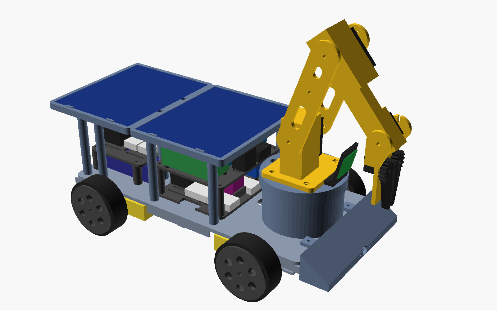

# Solar Rover: design (v0.2)

A rechargeable, solar-topped 4WD robot car with a 4-joint arm and gripper on a turret, styled after the Red Alert 2 Allied IFV with an Engineer inside (the "repair crane" version; see [inspiration.md](inspiration.md)). It can be driven by a handheld remote, by a phone over WiFi or Bluetooth, or by an onboard reinforcement-learning agent.



This page is the "why". The "how" is in [wiring.md](wiring.md), [modules.md](modules.md), [assembly.md](assembly.md), [software.md](software.md) and [protocol.md](protocol.md). Numbers marked *est.* are estimates to check on the real car.

**No custom circuit board.** The electronics are all off-the-shelf modules, joined with Dupont jumpers, screw terminals and lever connectors, and mounted on two slotted printed trays.

## Size and layout

- **Deck:** 300 × 146 mm. About 200 mm wide over the wheels. 65 mm wheels, skid-steer.
- **Prints on a 220 × 220 mm bed.** The deck is two halves joined with M3 screws. Every STL has been checked against that bed size.
- **Front to back:** nose wedge (with the distance sensor window), the turret and arm, then the solar roof over the electronics and the battery at the rear.
- **The arm parks folded forward** over the nose, so it never shades the panels.
- **The battery sits low at the rear**, as a counterweight to the arm.

## Power

```
Solar 2x 6 V 2 W (series) ── SS54 ─┐
12 V wall jack ───────────── SS54 ─┴─ relay (ESP32) ──── CN3795 MPPT 8.4 V ── 2S BMS ── 4x 18650 (2S2P, 44 Wh)
                                                                                     │
                                                         fuse 7.5 A ── switch ── motors / 6 V servo buck / 5.1 V logic buck
```

- **One charger for both sources.** The CN3795 tracks the panel's power point in the sun and charges at its full 1.5 A from the wall jack.
- **Temperature cut-off is mandatory.** The CN3795 has no temperature input and no enable pin, so the ESP32 reads a DS18B20 probe on the pack and switches the charger's input with a relay module. It only allows charging between 0 and 45 °C. The roof is PETG and the panels sit on posts with an air gap.
- **Solar is a top-up.** About 12 Wh on a sunny day is roughly an hour of driving, or keeps a parked car alive. The wall jack stays for a full charge in about 4 h.
- **Self-charging behaviour:**
  - Below 30 % the agent drops its task and looks for sun. It uses the panel's own power reading as a light sensor.
  - Below 15 % the ESP32 takes over: it parks the arm, shuts the Pi down, turns the radios off and naps.
  - At 60 % it wakes everything up again.

## Arm

| Joint | Servo | Link |
|---|---|---|
| Base yaw (turret) | MG996R | |
| Shoulder | MG996R | 100 mm |
| Elbow | MG996R | 90 mm |
| Wrist pitch | MG90S | 70 mm to the fingertips |
| Gripper (two gear-linked fingers) | MG90S | |

- **Payload:** objects up to about 50 g (*est.*), such as a bottle cap, a small block or a ping-pong ball. The torque margin is about 2.7× at the shoulder (modules.md).
- **Reach:** the shoulder axis is 148 mm above the ground. Pointing straight down, the gripper reaches the ground up to 18 cm from the turret, about 11 cm ahead of the nose, and all the way round with the base yaw.
- **Power limit:** the firmware moves one big servo at a time, so the 5 A servo rail isn't overloaded.

## Control

- **ESP32 (original WROOM-32)** does all the real-time work: motors and encoders, servos through a PCA9685, sensors, battery and charger logic, and every radio.
- **Raspberry Pi Zero 2 W** runs the agent and talks to the ESP32 over UART. It's optional: the same agent runs on a PC over WiFi.
- **Links:** handheld ESP-NOW remote, phone web app over WiFi, Bluetooth LE (Nordic UART), and UART to the Pi. They all use one text protocol ([protocol.md](protocol.md)).
- **Long range:** an E220 LoRa radio in the car and in the remote. The remote switches to it by itself when ESP-NOW stops getting through (about 100 m) and back when ESP-NOW returns, so the same remote drives the car out to 1–3 km in the open (*est.*), at 60 % top speed. Frames are signed and can't be replayed, the watchdog still stops the car if LoRa goes quiet for 700 ms, and an airtime budget keeps to each region's duty-cycle rule (protocol.md, "Long-range link").
- **Priority:** low-battery override first, then manual input, then the agent. In `auto` mode any manual input takes over for 2 s. If the driving link goes quiet for 300 ms, the motors stop.

## RL agent

- **Simulator:** a fast 2-D skid-steer simulator (`sim/`, Gymnasium API) with the car's size from the CAD, its speed limits, motor-strength and wheel-slip randomisation, sensor noise and obstacles. A MuJoCo 3-D model of the car and arm (`sim/models/solar_rover.xml`) is included for later arm work.
- **Training:** Evolution Strategies, numpy only, on any PC. PPO from Stable-Baselines3 is an optional alternative.
- **Policy:** a 14-input, 2-output MLP. It reads the goal direction, wheel speeds, gyro, front distance, light and battery level, and outputs throttle and turn at 10 Hz. It ships as `.npz` and `.onnx`.
- **Behaviours on the car:** waypoint navigation with the learned policy, sun seeking (a scripted search by default, since it did better in the sim), and an optional camera-based pick-up.

## What changed since v0.1, and why

| v0.1 | v0.2 | Why |
|---|---|---|
| Bluetooth gamepad via Bluepad32 | Printed handheld remote on ESP-NOW | Bluepad32 needs its own build of the ESP32 Arduino core and shares the radio with WiFi and BLE. ESP-NOW works alongside the web app, needs no router, and the remote's parts are cheap. |
| Shoulder 120 mm high, gripper 15 cm ahead of the nose | 148 mm high, 10 cm ahead | Measured on the real CAD. The turret has to clear the deck electronics. |
| 608 bearing + thrust ring under the turret | The base-yaw MG996R carries the turret directly, with M3 inserts | Fewer parts. The servo's metal output takes the arm load at this size. |
| Deck 300 × 200 mm | Deck 300 × 146 mm, 200 mm over the wheels | The wheels sit outside the deck. |
| Hinged roof | Roof trays on posts, 4 × M3 each | Simpler to print. The battery is reached by lifting off the rear roof tray and the charge tray. |
| Wrist link 60 mm | 70 mm | Room for the gripper gears. |
| Perfboards, MOSFET charger switch, NTC + resistor | Expansion board, I2C hub, relay module, DS18B20 probe module, lever connectors | No custom circuit board: everything is a module wired with jumpers and lever connectors. |
| All power modules on one tray, roof posts 50 mm, trays 22 mm apart | Charging modules on a new charge tray over the battery; roof posts 75 mm; trays 32 mm apart | `tools/fit_check.py` showed the modules didn't fit on one tray at their real sizes, and that plugged-in jumpers on the PCA9685, TB6612s and ESP32 board hit the tray or roof above. |
| Park pose 100/140/−60 | 110/120/−70 (shoulder/elbow/wrist) | The fit check showed the old pose put the fingers into the camera. The new one sits in the middle of a collision-free range. |
| Shoulder always moved before the elbow | The elbow unfolds before the shoulder lowers, and the shoulder rises before the elbow folds | `fit_check.py --paths` showed park → pick and carry → pick drove the gripper into the turret and nose. |
| Arm IK used a 70 mm hand | 73.5 mm, plus the 5 mm finger offset | The IK now matches the 3D model to 0.3 mm. The old numbers put the fingers 3 mm into the floor. |
| Remote range limited to ESP-NOW, about 100 m | E220-900T22D LoRa module in the car and the remote; the remote fails over to it automatically | To drive beyond ESP-NOW range. LoRa reaches 1–3 km in the open on cheap (~$8) modules. The E220 has its own MCU and a UART, so it needs 3 pins and no soldering; an SPI board (RFM95) needs 6 pins the car doesn't have. ESP-NOW stays the main link because it's 5× faster. Cellular/4G was considered and left out: a monthly SIM, variable latency and a server in between, for a car you need to see to drive (protocol.md). |
| Motor STBY on GPIO13 | GPIO12; the radio uses GPIO13 (RX), GPIO14 (TX) and GPIO0 (mode) | The only free pins were 0, 12 and 14, and 0 and 12 are boot-strapping pins. GPIO12 must be low at reset, which the TB6612s' own STBY pull-downs guarantee. GPIO0 must be high at reset, which is also the radio's setup mode, so the firmware sets the radio up at every boot. |

## Known unknowns

- **Untested design.** Nothing here has been built yet. `tools/fit_check.py` checks the 3D model for parts that run into each other (every part, the module stand-ins with their plugged-in jumpers, and the arm in each firmware pose at three turret angles), and with `--paths` every move between the firmware poses, as the firmware sequences the joints. It can't check the real parts' tolerances. Print the motor clamp, a wheel and the turret base first to check the fits.
- **MEASURE items** in `hardware/scad/config.scad`: the TT motor, the servos, the panels and the board hole patterns vary between suppliers. Measure them and re-export the STLs.
- **Firmware:** the car and remote firmware compile cleanly (no warnings) with PlatformIO `espressif32@6.9.0` (Arduino core 2.0.17). The car uses 38% of flash and 18% of RAM. GitHub Actions rebuilds both on every push. They haven't run on real hardware yet.
- **Long-range link:** the range is the vendor's figure scaled down for the 9.6 kbit/s air rate and stock antennas; measure it (software.md, "Range test"). The E220 pin behaviour at reset (M0/M1 inputs not pulling GPIO0 low) is from the datasheet: if the car ever boots into download mode with the radio fitted, move the M0/M1 jumper off GPIO0 to check.
- **Policy:** trained in simulation only. Expect to retune `speed_scale` and the sim's motor numbers on the real car.
